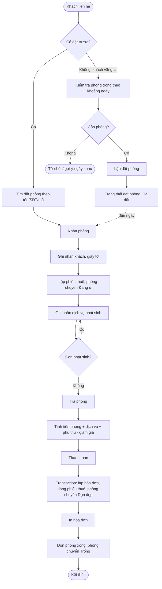
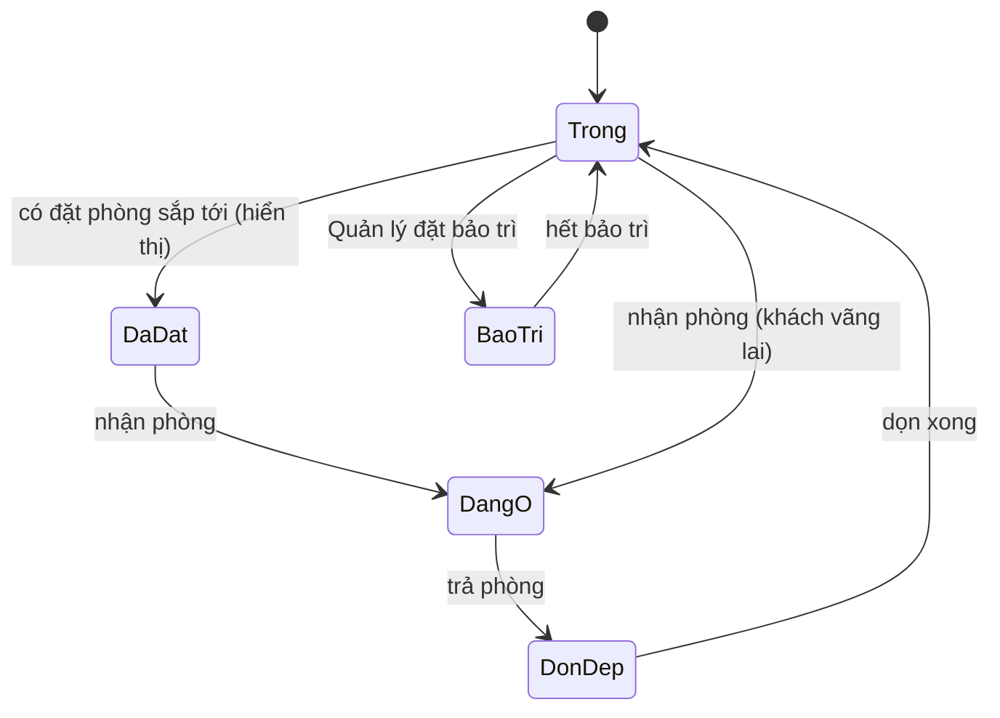

# 1.2 – Quy trình nghiệp vụ

Quy trình chính: **Đặt phòng → Nhận phòng → Dịch vụ → Trả phòng → Hóa đơn**.

Sơ đồ mô tả quy trình nghiệp vụ mục tiêu. Trong source hiện tại, lễ tân tạo, hủy đặt phòng hoặc đánh dấu khách không đến (chưa có sửa đặt phòng); việc đặt phòng không tự đổi cột trạng thái lưu trong bảng `Phong`. Trạng thái “Đã đặt” được suy ra khi tra cứu nếu có đặt phòng còn hiệu lực.

## 1. Sơ đồ tổng quát

## 2. Mô tả từng bước

| Bước | Hoạt động | Người thực hiện | Dữ liệu vào | Dữ liệu ra / thay đổi |
|---|---|---|---|---|
| 1 | Tìm phòng trống theo khoảng ngày | Lễ tân | Ngày đến, ngày đi, loại phòng, số người | Danh sách phòng trống |
| 2 | Lập đặt phòng | Lễ tân | Khách, phòng, ngày đến/đi, tiền cọc (nếu có) | Bản ghi **DatPhong** trạng thái Đã đặt; trạng thái hiển thị phòng được tính khi tra cứu |
| 3 | Nhận phòng | Lễ tân | Đặt phòng hoặc thông tin khách vãng lai, giấy tờ | Bản ghi **PhieuThue**, phòng → Đang ở, đặt phòng → Đã nhận |
| 4 | Ghi nhận dịch vụ | Lễ tân | Phiếu thuê, dịch vụ, số lượng | Dòng **ChiTietDichVu** |
| 5 | Trả phòng | Lễ tân | Phiếu thuê | Tổng tiền phòng, dịch vụ, phụ thu |
| 6 | Thanh toán và lập hóa đơn | Lễ tân | Tổng tiền, giảm giá, hình thức thanh toán | Bản ghi **HoaDon**, phiếu thuê đóng, phòng → Dọn dẹp |
| 7 | In hóa đơn | Lễ tân | Hóa đơn | Bản in |
| 8 | Dọn phòng xong | Nhân viên được thao tác sơ đồ | Xác nhận hoàn tất dọn phòng | Cột trạng thái phòng → Trống; khi tra cứu, phòng có đặt trước còn hiệu lực có thể hiển thị Đã đặt |

## 3. Các nhánh ngoại lệ

| Tình huống | Xử lý |
|---|---|
| Khoảng ngày đặt trùng với đặt phòng/phiếu thuê khác của cùng phòng | Báo lỗi, không lưu. Gợi ý phòng khác cùng loại |
| Khách hủy đặt phòng | Đặt phòng → Đã hủy, phòng được giải phóng cho khoảng ngày đó |
| Khách không đến | Yêu cầu nghiệp vụ: đặt phòng → Không đến sau giờ quy định. Đã có thao tác "Khách không đến" trong màn hình Đặt phòng. |
| Khách trả phòng sớm | Tính tiền theo số đêm thực tế, ngày đi thực tế ghi vào phiếu thuê |
| Khách ở lâu hơn dự kiến | Kiểm tra phòng còn trống không; nếu có đặt phòng sau đó thì đổi phòng hoặc từ chối gia hạn |
| Lỗi khi lưu hóa đơn lúc trả phòng | Transaction rollback, phiếu thuê và phòng giữ nguyên trạng thái cũ |

## 4. Vòng đời trạng thái

**Phòng**

Trạng thái “Đã đặt” là trạng thái hiển thị suy ra từ đặt phòng còn hiệu lực; các trạng thái Trống, Dọn dẹp và Bảo trì được lưu ở bản ghi phòng. Khi có phiếu thuê đang ở, trạng thái hiển thị là Đang ở.

**Đặt phòng**: Đã đặt → Đã nhận / Đã hủy / Không đến.

**Phiếu thuê**: Đang ở → Đã trả.

## 5. Màu hiển thị trạng thái phòng (dùng cho NV03)

| Trạng thái | Màu gợi ý |
|---|---|
| Trạng thái | Màu giao diện hiện tại (xấp xỉ) |
|---|---|
| Trống | Xanh nhạt |
| Đã đặt | Vàng nhạt |
| Đang ở | Cam/đỏ nhạt |
| Dọn dẹp | Nâu nhạt |
| Bảo trì | Xám/nâu nhạt |

Màu được xác định trong `UcTrangThaiPhong`; mã màu cụ thể có thể thay đổi theo theme.
